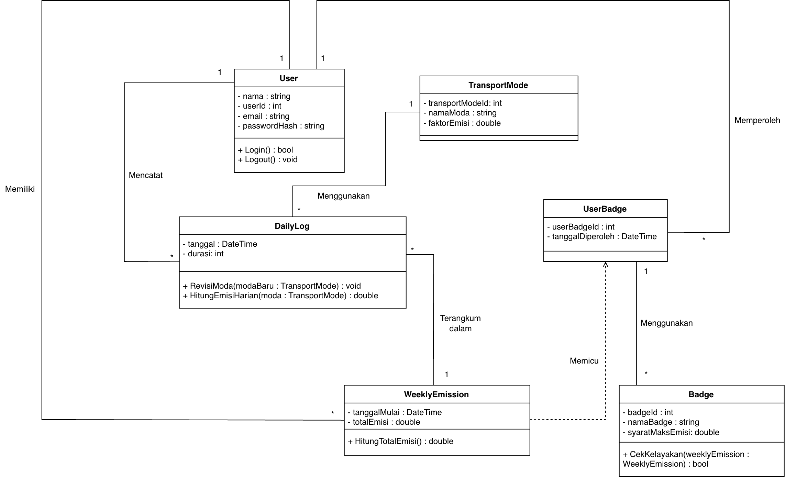

# GreenRide

Aplikasi desktop untuk mencatat perjalanan harian, menghitung estimasi emisi CO₂ dari moda transportasi yang dipakai, dan mengajak pengguna menurunkan emisinya lewat badge mingguan dan leaderboard.

Proyek mata kuliah Junior Project, Departemen Teknik Elektro dan Teknologi Informasi, Fakultas Teknik, Universitas Gadjah Mada.

## Fitur

- **Akun**: daftar dan masuk dengan email dan password (password disimpan sebagai hash BCrypt).
- **Catat perjalanan**: pilih moda (motor, mobil, bus Trans Jogja, kereta api), timer berjalan, emisi dihitung dari durasi dan faktor emisi moda.
- **Ringkasan**: grafik emisi mingguan, kalender emisi bulanan, dan tabel perjalanan harian. Perjalanan hari ini bisa direvisi.
- **Badge mingguan**: Eco Initiate, Carbon Tamer, Terra Sentinel, dan Zero Trace, dihitung otomatis dari total emisi satu minggu.
- **Leaderboard**: peringkat pengguna berdasarkan emisi minggu berjalan, emisi terendah di peringkat 1.

## Aturan penilaian

| Hal | Aturan |
|---|---|
| Minggu | Senin sampai Minggu |
| Badge | Total emisi seminggu: Zero Trace 0 kg, Terra Sentinel ≤ 3 kg, Carbon Tamer ≤ 6 kg, Eco Initiate ≤ 10 kg. Perjalanan harus tercatat di 7 hari berbeda, dan hanya badge tertinggi yang diberikan. |
| Kalender | Hijau ≤ 0,43 kg, kuning ≤ 1,43 kg, merah > 1,43 kg per hari |
| Leaderboard | Hanya pengguna yang mendaftar sebelum Senin minggu itu |

## Teknologi

- C# dan .NET 8
- Avalonia UI 11 dengan pola MVVM (CommunityToolkit.Mvvm) dan dependency injection
- PostgreSQL di Supabase, diakses lewat Npgsql
- BCrypt.Net-Next untuk hash password
- REST API Supabase (fungsi RPC) untuk leaderboard

## Struktur repositori

```
GreenRide.UI/        Aplikasi desktop (Avalonia)
  Models/            Model data
  Services/          Antarmuka layanan dan repository PostgreSQL
  Helpers/           Aturan badge, kalender, kalkulator emisi, utilitas minggu
  ViewModels/        Logika tampilan
  Views/             Tampilan (XAML)
  Styles/            Warna, tipografi, dan gaya komponen
docs/                Skema database, SQL endpoint leaderboard, dan situs dokumentasi
*.cs di akar         Prototipe konsol awal (milestone OOP, GreenRide.csproj)
```

## Menjalankan

Prasyarat: [.NET 8 SDK](https://dotnet.microsoft.com/download/dotnet/8.0) dan sebuah database PostgreSQL (misalnya proyek Supabase).

1. Jalankan `docs/schema.sql` di database (Supabase: SQL Editor).
2. Salin `.env.example` menjadi `.env` di akar repositori, lalu isi `GREENRIDE_DB` dengan connection string. Berkas `.env` tidak boleh di-commit.
3. Jalankan:

```bash
dotnet run --project GreenRide.UI
```

### Leaderboard lewat API (opsional)

1. Jalankan `docs/leaderboard_api.sql` di database. Berkas itu membuat fungsi `leaderboard_minggu_ini`, mengaktifkan Row Level Security, dan memberi izin panggil kepada peran `anon`. Sesuaikan nama peran aplikasi pada baris `CREATE POLICY` bila peran database Anda bukan `greenride_app`.
2. Isi `GREENRIDE_API_URL` (URL proyek Supabase) dan `GREENRIDE_API_KEY` (kunci anon atau publishable) di `.env`.

Bila dua variabel itu kosong atau API tidak terjangkau, aplikasi otomatis memakai koneksi database langsung, sehingga leaderboard tetap tampil.

### Membuat berkas `.exe`

```bash
dotnet publish GreenRide.UI -c Release -r win-x64 --self-contained true -p:PublishSingleFile=true -p:IncludeNativeLibrariesForSelfExtract=true -o ../GreenRide-paket
```

Letakkan berkas `.env` di folder yang sama dengan `GreenRide.UI.exe`. Pengguna tidak perlu memasang .NET. Untuk komputer lain, ganti `win-x64` dengan `osx-arm64` (Mac chip Apple) atau `osx-x64` (Mac Intel).

## Anggota Kelompok 12

| Nama | NIM |
|---|---|
| Aqidatul Izzah (ketua) | 24/533730/TK/59137 |
| Bintang Khalifa Hadianto | 24/534951/TK/59312 |
| Rasyid Rayhan Novandy | 24/545518/TK/60688 |


